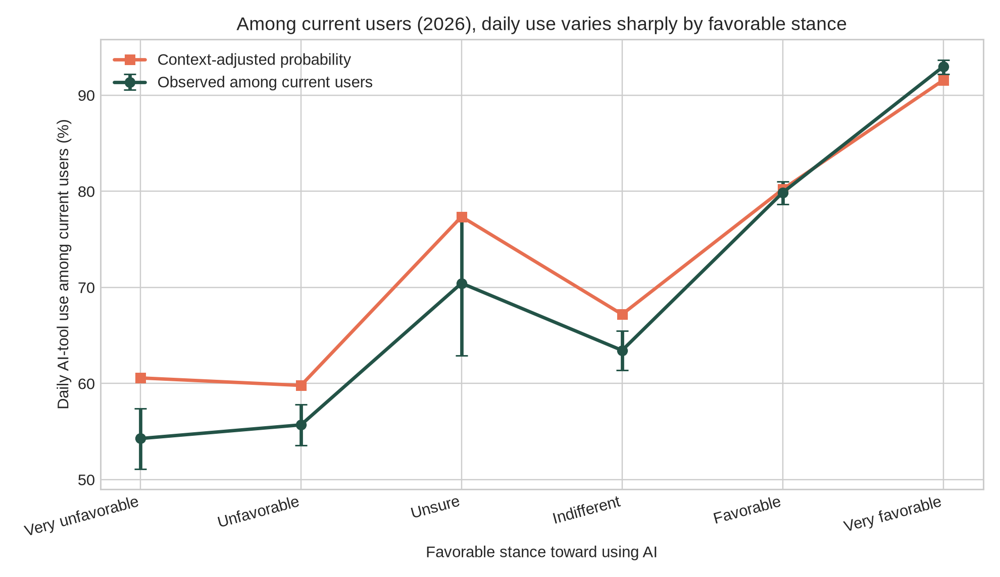

# Adoption Without Confidence

## AI use attitude and trust in the 2025 and 2026 Stack Overflow surveys

Josh Penzell | Imagination Applied Open Research Series | November 2026

Daily AI use can coexist with an unfavorable view of the tools. In the 2026 Stack Overflow survey, 54% of current AI users with a very unfavorable attitude reported daily use of at least one tool type. Among very favorable users, the figure was 93%. A usage count tells you how often someone uses a tool. It does not tell you whether they welcome it, trust its output, or benefit from it.

This analysis examines 14,158 current AI users in 2026 and 26,102 in 2025 who answered the study's use, attitude, and trust items. These are separate samples from a voluntary survey, not the same people followed over time. The 2026 survey redesigned all three core questions. Comparisons within each year are the strongest evidence; differences between years combine possible behavioral change with changes in measurement and respondents.

## What the 2026 results show

**Frequent use and negative attitudes coexist.** Of 958 very unfavorable current users in the analysis, 520 reported daily use: 54.3%, with a Wilson 95% interval of 51.1% to 57.4%. Among 4,512 very favorable users, 4,195 reported daily use: 93.0%, with an interval of 92.2% to 93.7%. The difference remains substantial. Attitude has not become irrelevant to frequency.

**Attitude distinguished daily from less frequent use better than the survey's trust item did.** Five-fold cross-validated ROC AUC was 0.722 for attitude alone and 0.657 for trust alone. With the same demographic and work-context variables added, the corresponding values were 0.761 and 0.713. The context-plus-attitude model outperformed context-plus-trust in all 50 matched train/test splits, as it did in the 2025 analysis. These results concern classification of contemporaneous self-reports, not predictions of future behavior or evidence that changing attitudes causes use.

**Trust is conditional.** Among 14,179 current users with usable frequency and trust answers in 2026, 48.2% selected trust when they can easily verify the output, 16.4% trust for many tasks but not important work decisions, 16.2% trust for low-risk tasks only, 12.1% no trust for most work tasks, and 6.7% trust including important decisions. The remaining 0.5% selected the uncertain or non-use option. These categories describe different conditions for trust; they are not a simple ladder from low to high trust.

**Organizational policy is associated with frequency.** Among very unfavorable current users who answered the policy item, daily use was 45.8% where use was optional (93 of 203) and 67.6% where it was measured in performance reviews (96 of 142). The corresponding rates across all attitudes were approximately 70% and 88%. These associations do not establish that measurement causes use or dissatisfaction. Work requirements, job roles, tool access, and selection into organizations may also matter.

## How 2025 provides context

| Measure | 2025 | 2026 |
| --- | --- | --- |
| Current users with complete core answers | 26,102 | 14,158 |
| Daily use among very unfavorable users | 18.8% (110 of 585) | 54.3% (520 of 958) |
| Daily use among very favorable users | 88.1% (6,528 of 7,408) | 93.0% (4,195 of 4,512) |
| Daily use in the primary sample | 59.9% | 76.2% |
| Attitude-only AUC | 0.758 | 0.722 |
| Trust-only AUC | 0.669 | 0.657 |
| Context plus attitude AUC | 0.790 | 0.761 |
| Context plus trust AUC | 0.704 | 0.713 |

In 2025, daily use came from a single question about AI tools in the development process. In 2026, it means reporting daily use on any of four tool types at work: coding assistants or agents, general-purpose chat tools, agents or automated workflows, and internal company tools. Attitude response labels also changed, and trust shifted from perceived accuracy to conditions and task scope. The observed endpoint gap is smaller in 2026, but these figures do not isolate a change in the underlying population.

The broader current-user attitude tables show favorable shares of 84.8%, 76.8%, 72.6%, and 62.3% in 2023 through 2026. Each percentage uses that year's current users who answered the attitude item, rather than the smaller complete-case modeling sample. These are descriptive results from four different survey samples. The wording change in 2026 and changes in recruitment and validity rules limit a trend interpretation.

The redesigned trust item added about 0.012 AUC beyond attitude and context across the 2026 repeated splits; the 2025 trust item added about 0.003. That difference does not demonstrate that the new question is four times better, or that question design caused an improvement. The years differ in their samples, outcomes, and measures.

## Implications for an AI rollout

Measure use, attitude, and conditions for trust separately. Someone can use AI every day and still dislike it. Someone can regard it favorably while limiting its use to tasks they can check. A dashboard needs room for both possibilities.

Alongside frequency, ask people how they feel about using the tools in their work and which tasks they are comfortable using them for. Ask how they check the result. Then assess the outcomes that matter for the work: quality, errors, time, and the ability to explain or defend a decision. Those are practical recommendations prompted by the findings; this survey did not test whether those measures improve a rollout.

Higher use under a measured-use policy is not evidence of better work. The survey cannot tell whether a particular policy improves performance, develops judgment, or simply changes reported frequency. A workplace pilot with direct outcome measures would help answer those questions.

## Scope and limitations

The primary analysis uses separate logistic-regression models for each year. Attitude and trust are categorical variables. Context includes age, employment, role, organization size, work setting, experience, and country. Five-fold cross-validation, ten repetitions of stratified five-fold cross-validation for three context models (50 matched train/test splits), country-grouped validation, and a professional-user sensitivity analysis assess the stability of the reported associations. The 50 overlapping splits are robustness checks, not 50 independent replications.

All measures are self-reported at one time. The survey is voluntary, has no supplied population weights, and cannot represent all developers or establish cause and effect. The primary analysis excludes non-users and respondents missing core answers; it concerns frequency among current users, not the decision to start using AI. Complete-case selection can affect the results. The role recode places 21% of eligible role answers in 2025 and 24% in 2026 in an Other category, limiting the context adjustment. The 2026 trust options are modeled as nominal categories, without imposing an ordinal ranking.

This is a secondary analysis of Stack Overflow's public survey data. The supplied research package documents the 2026 mapping and replication criteria; contemporaneous preregistration of those criteria has not been independently established in this review. The 2025 and 2026 analyses are presented together for publication. No claim of novelty or first discovery is made.

## Sources and reproducibility

Stack Overflow Developer Survey 2025 and 2026 public CSVs and schemas: https://github.com/StackExchange/Survey/tree/main/packages/archive

Stack Overflow 2026 AI results: https://survey.stackoverflow.co/2026/ai

Analysis repository: https://github.com/jpenzell/ai-adoption-paradox

The accompanying research folder contains the code, item mappings, source tables, and verification notes. Headline counts come from current_user_daily_use_by_stance.csv; model comparisons from primary_current_user_model_comparison.csv and primary_repeated_cv_comparisons.csv; policy results from current_user_daily_by_stance_and_org_policy.csv; and annual attitude and trust distributions from four_year_context.csv. Data attribution: Stack Overflow Developer Survey, ODbL 1.0.

## Daily AI use by attitude in 2026

Source: 2026 Stack Overflow Developer Survey, secondary analysis. Daily means at least one of four AI tool types. Display labels are harmonized to the 2025 categories; Unfavorable and Favorable mean Somewhat unfavorable and Somewhat favorable in 2026. Error bars describe sampling uncertainty within this voluntary sample; they do not correct selection bias.
